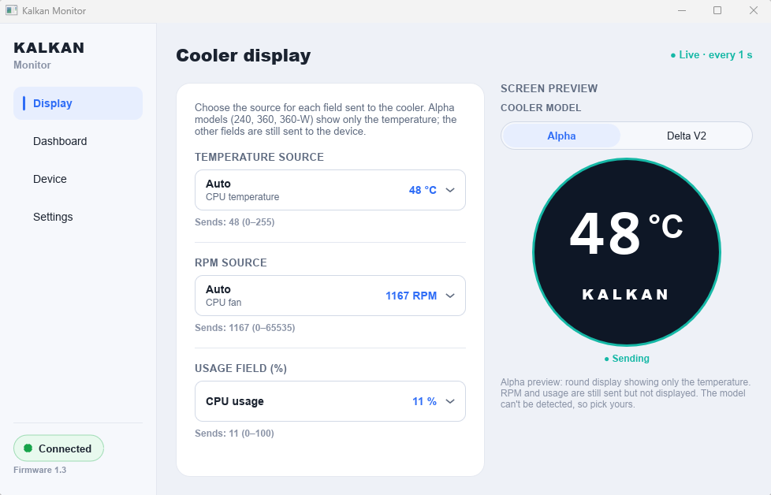
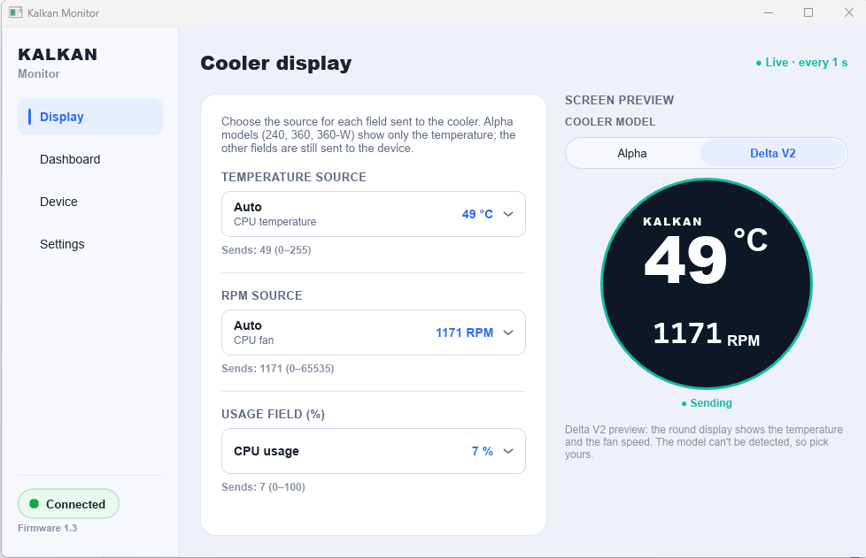

# Kalkan Monitor RS: monitor for Kalkan Alpha 240/360/360-W and Delta V2 240/360 AIO watercoolers

**English** | [Português (Brasil)](README-PT.md)

Free, open-source, cross-platform (Windows / macOS / Linux) monitor for the
**Kalkan Alpha** and **Delta V2** AIO liquid coolers. It reads your **CPU
temperature** and shows it on the cooler's display, as an alternative to the
official Kalkan PC SmartMonitor software.

<table>
  <tr>
    <td align="center"><br><sub>Alpha</sub></td>
    <td align="center"><br><sub>Delta V2</sub></td>
  </tr>
</table>

## Download

Get the latest version from the
**[Releases page](https://github.com/medeiroz/kalkan-monitor-rs-v1.3/releases/latest)**
(open **Assets** and pick the file for your system):

| System | File to download | Notes |
| --- | --- | --- |
| Windows (64-bit) | `KalkanMonitor-Setup-<version>.exe` (installer) | Includes everything, including the sensor driver |
| Linux (Debian, Ubuntu and derivatives, 64-bit) | `kalkan-monitor_<version>_amd64.deb` | Includes the USB permission rule |
| macOS 11 or later (Apple Silicon and Intel) | `KalkanMonitor-<version>.dmg` | Universal app |

**Windows.** Run the installer and follow the steps. When you open the app it
asks for **administrator permission** (the Windows UAC prompt): it is needed to
read the CPU temperature and fan speed. Accept it. If you decline, the app still
opens but shows a warning and cannot read the sensors.

**Linux.** Double-click the `.deb` (or run `sudo apt install ./kalkan-monitor_<version>_amd64.deb`).
The package already sets up the permission to talk to the display: **unplug and
plug the cooler's USB cable again** after installing. Other distributions:
see [Install (Linux)](#install-linux).

**macOS.** Open the `.dmg` and drag **Kalkan Monitor** to **Applications**, then
open it from there. The first time, macOS may say the app is from an
"unidentified developer": right-click the app, choose **Open**, then **Open**
again (details in [Install (macOS)](#install-macos)).

## Supported coolers

The official Kalkan list (see [kalkan.com.br/cooler](https://www.kalkan.com.br/cooler)):

| Cooler | Model code | Notes |
| --- | --- | --- |
| [Kalkan Alpha 240](https://www.kalkan.com.br/produto/alpha-240) | KLK047 | 240 mm AIO watercooler, round LCD showing only the CPU temperature. Alpha Rev.2 (firmware 1.3); Rev.1 is experimental (see below) |
| [Kalkan Alpha 360](https://www.kalkan.com.br/produto/alpha-360) | KLK048 | 360 mm AIO watercooler, round LCD showing only the CPU temperature. Alpha Rev.2 (firmware 1.3); Rev.1 is experimental (see below) |
| [Kalkan Alpha 360-W](https://www.kalkan.com.br/produto/alpha-360w) | KLK049 | White version of the Alpha 360. Alpha Rev.2 (firmware 1.3); Rev.1 is experimental (see below) |
| [Kalkan Delta V2 240](https://www.kalkan.com.br/produto/delta-v2-240) | KLK066 | 240 mm AIO watercooler, compatible by protocol; not yet tested on hardware |
| [Kalkan Delta V2 360](https://www.kalkan.com.br/produto/delta-v2-360) | KLK067 | 360 mm AIO watercooler, compatible by protocol; not yet tested on hardware |
| Kalkan Alpha 240 / 360 / 360-W **Rev.1** (sold before Jan/2026, firmware 1.2) | KLK047 / KLK048 / KLK049 | **Experimental**: implemented, not yet tested on real hardware |

**Alpha 240 / 360 / 360-W:** the **round display shows only the CPU
temperature**. Fan RPM and load are not shown on the screen (the app still sends
them in the protocol frame, but these models do not display them).

**Delta V2 240 / 360:** compatible by protocol (same official software); **not
yet tested on hardware**. The official "Kalkan PC SmartMonitor (Linha Delta V2)
V1.3" Windows software was verified statically to be the exact same application
binary (same SHA-256) this protocol was derived from, so the USB IDs
(`1F3A:0008` / `1A86:484A`), serial settings and frame format are identical.
What the Delta V2 display shows (shape and fields) has not been verified; the
official software sends temperature and fan speed. If you own a Delta V2,
reports are welcome: please open an issue with the output of `kalkan list`.

**Alpha Rev.1 (sold before Jan/2026, firmware 1.2): experimental, not yet tested
on real hardware.** These older units use a different protocol (USB HID
`0416:1100` with a handshake) instead of the serial port of Rev.2. The app
implements it from a static analysis of the official 1.2 software and picks it
by itself when no Rev.2 / Delta V2 cooler is plugged in. Reports are welcome:
run `kalkan list` and `kalkan handshake`, then open an issue with their output
and what the display showed. Which revision is yours? The box label has the
manufacturing date after the SKU (e.g. `KLK00047 - 20251106XXX` is November
2025, so Rev.1).

## Features

- Shows your **CPU temperature** on the cooler's display, updated every second.
- Dashboard with live CPU temperature, fan speed and CPU usage.
- **Choose the sources**: pick which sensor feeds the temperature and RPM fields
  (Auto, Max CPU/GPU, or any temperature/fan sensor on your PC).
- **Screen preview** of what the cooler shows, for Alpha and Delta V2.
- **Tray icon** (menu bar on macOS): closing the window keeps the app running
  and updating the display.
- **Start with the system**: enabled on the first run, you can turn it off in
  **Settings**.

## How to use

1. Connect the cooler's USB cable to your PC (the cooler's own USB connection,
   the one used by the official software) and close the official Kalkan software
   if it is installed.
2. Open **Kalkan Monitor**. The status at the bottom left should say **Connected**.
3. On the **Display** page, check the temperature and RPM sources (**Auto** is
   fine for most PCs) and pick your cooler model (Alpha or Delta V2) for the preview.
4. That is it: you can close the window, the app keeps running in the tray.
   Change **Settings** if you do not want it to start with the system.

## Troubleshooting / FAQ

**The cooler's display is stuck at "88°".** The display is not getting data it
understands. First **close the official Kalkan software** (two programs talking
to the display at once get in each other's way). If it stays at 88°, the cooler
probably has the other hardware revision: Alpha **Rev.2** (sold from January
2026) and Delta V2 use firmware 1.3; Alpha **Rev.1** (sold before January 2026)
uses firmware 1.2, which is supported experimentally and not yet tested on real
hardware. Run `kalkan list`: it marks the cooler with `★ firmware 1.3` or
`★ firmware 1.2`. For a Rev.1, `kalkan handshake` shows whether it answers;
please report the result in an issue.

**Do I need to close the official Kalkan software?** Yes. Only one program
should talk to the display at a time: on Windows both would send frames and the
display would get a mix of them, and on macOS the second one cannot open a Rev.1
display at all.

**The app says the cooler was not found.** Check that the USB cable is plugged
in, try another USB port, and **close the official Kalkan software** or any
other program that may be using the display. Then replug the cable.

**Windows keeps asking for administrator permission / shows a warning.** The app
needs it to read the temperature sensors. Restart the app and accept the prompt.
It starts with the system without asking again.

**Linux: "Permission denied" opening the display.** Install the `.deb` (it adds
the permission rule) and replug the cooler. Without the rule, run
`sudo usermod -aG dialout $USER` (`uucp` on Arch) and log in again. An Alpha
Rev.1 (firmware 1.2) shows up as a `/dev/hidraw*` device instead: it needs the
udev rule (the `dialout` group does not help). Details in
[Install (Linux)](#install-linux).

**macOS: the display is plugged in but no port is found.** The display's USB
chip (CH34x) may need a driver on older macOS versions: install WCH's
CH34xVCPDriver from [wch-ic.com](https://www.wch-ic.com/), allow it in **System
Settings → Privacy & Security** and replug the cooler. Details in
[Install (macOS)](#install-macos).

**Is my Delta V2 supported?** It is compatible by protocol, but it has not been
tested on real hardware yet. Reports are welcome (open an issue with the output
of `kalkan list`).

**Is my Alpha Rev.1 supported?** Experimentally: the firmware 1.2 protocol is
implemented but has not been tested on real hardware yet. Reports are welcome
(open an issue with the output of `kalkan list` and `kalkan handshake`).

---

# Technical details

The sections below are for the curious and for contributors.

It is a Rust reimplementation of the driver + interface for the **Kalkan
SmartMonitor 1.3** protocol used by these coolers, plus an experimental port of
the older **1.2** protocol (Alpha Rev.1, USB HID; see
[`docs/v1.2/protocol.md`](docs/v1.2/protocol.md)). A new project — it
is not the original `.exe` translated; it is a reconstruction based on reverse
engineering its behavior (see [`docs/v1.3/protocol.md`](docs/v1.3/protocol.md)), with a
new modern UI on top.

## Why it exists

The original software is Windows-only: it uses HWiNFO for sensors and a Qt/QML
app for the UI (and, in the installed version, it also disables UAC — removed
separately). Here the useful logic — reading sensors and talking to the cooler's
display over serial — becomes a portable core, and the interface is rebuilt from
scratch.

## What is different in 1.3

Compared to 1.2, the 1.3 is **simpler** (details in `docs/v1.3/protocol.md`):

- **serial-only** transport (USB-serial), without the 1.2's HID path;
- device found by **fixed VID/PID** (`1F3A:0008` or `1A86:484A`), opened at
  **1 Mbps, 8N1, no flow control**;
- **no handshake / no seed**;
- **5-byte** frame `74 00 temp fanHi fanLo`, scrambled with an **XOR `0x02`**
  from byte 2 onward (no `cpu_load`, no frame index).

## Structure

```
crates/
  kalkan-core/   # core: sensors, firmware selection, transports
    src/v1_3/    #   firmware 1.3: serial, 5-byte frame (Alpha Rev.2, Delta V2)
    src/v1_2/    #   firmware 1.2: USB HID, handshake, 64-byte frame (Alpha Rev.1, experimental)
  kalkan-cli/    # `kalkan` utility (list, sensors, frame, send, handshake, hwinfo, hid)
  kalkan-ui/     # modern dashboard (Slint, light theme) → `kalkan-monitor` bin
sidecar/
  kalkan-sensord/ # Windows sensors via LibreHardwareMonitor (.NET)
windows/
  installer/    # Windows installer (Inno Setup) + build.ps1
linux/          # .deb packaging files: udev rule, .desktop, icons, maintainer scripts
macos/          # .app/.dmg packaging: Info.plist template + build.sh
docs/
  README.md      # documentation index
  v1.3/
    protocol.md  # reverse-engineering findings (reconstructed 1.3 protocol)
  v1.2/
    protocol.md  # 1.2 (HID) protocol notes: implemented, experimental, untested on hardware
```

## Install (Windows)

Download `KalkanMonitor-Setup-<version>.exe` from
[Releases](https://github.com/medeiroz/kalkan-monitor-rs-v1.3/releases). It installs the
dashboard, the sensor sidecar and the **PawnIO** driver (needed to read
temperature/fan, including with Memory Integrity turned on). Nothing else to
install separately.

To build the installer locally: `./windows/installer/build.ps1 -Version 0.1.0`
(needs Rust, .NET 8 SDK and Inno Setup 6).

### Tray and start with the system

- Closing the window keeps the app running in the **tray** (it keeps updating
  the display). Left-click the icon to reopen it; right-click → **Close
  monitor** quits. Opening the app again while it runs just shows the window.
- **Settings → Start with the operating system** registers the app to start
  hidden in the tray at login. It is enabled on the first run (once; turn it
  off in Settings and it stays off):
  - Windows: a Task Scheduler task (`Kalkan Monitor`, at logon, highest
    privileges), so it starts elevated without a UAC prompt. The uninstaller
    removes it.
  - macOS: a LaunchAgent in `~/Library/LaunchAgents` that runs the executable
    inside the installed `Kalkan Monitor.app`, so enable it from the copy in
    Applications (see [Install (macOS)](#install-macos)).
  - Linux: an entry in `~/.config/autostart`. The tray needs a StatusNotifier
    host (see [Install (Linux)](#install-linux)); without one, closing the
    window quits and the window opens at login instead of staying hidden.

### Publishing a release

Releases are automatic: every push to `main` whose Windows, Linux and macOS builds all succeed
makes GitHub Actions create the tag `v<MAJOR.MINOR>.<run number>` (MAJOR.MINOR from the version in
`Cargo.toml`) and the Release. Never push tags by hand. To bump MAJOR.MINOR, change `version` in
`[workspace.package]`.

GitHub Actions (`.github/workflows/release.yml`) builds the Windows installer,
the Linux `.deb` and the macOS `.dmg` and creates the Release with them attached. Every push/PR runs the tests on Windows,
Linux and macOS (`ci.yml`).

## Install (Linux)

Download `kalkan-monitor_<version>_amd64.deb` from
[Releases](https://github.com/medeiroz/kalkan-monitor-rs-v1.3/releases) and install it:

```bash
sudo apt install ./kalkan-monitor_<version>_amd64.deb
```

The package installs the `kalkan-monitor` app, a desktop entry, an icon and the
**udev rule** that lets you open the display (its serial port, or the
`/dev/hidraw*` node of an Alpha Rev.1). Other distros: build
from source (below) and copy [`linux/udev/60-kalkan-monitor.rules`](linux/udev/60-kalkan-monitor.rules)
to `/etc/udev/rules.d/`.

**Serial port access.** The display shows up as `/dev/ttyUSB*` or `/dev/ttyACM*`,
which normal users cannot open by default. The udev rule grants access to the
user logged in at the machine (`TAG+="uaccess"`), with a `dialout` group
fallback. After installing it, **replug the display** (the package also reloads
the rules). Without the rule, add yourself to the group and log in again:

```bash
sudo usermod -aG dialout $USER   # "uucp" on Arch
```

If the port cannot be opened, the app says so in the error banner and repeats
this fix.

**Alpha Rev.1 (firmware 1.2, experimental)** is a USB HID device
(`/dev/hidraw*`, `0416:1100`). The same udev rule file grants access to it
(`TAG+="uaccess"`); the `dialout` group does not apply. After installing the
rule, replug the cooler or run
`sudo udevadm control --reload-rules && sudo udevadm trigger --subsystem-match=hidraw`.

**Sensors** come from the kernel's hwmon interface (`/sys/class/hwmon`): CPU,
GPU, motherboard fans, NVMe drives, memory and liquid coolers, grouped by
category in the source selectors, with Auto picks for the CPU temperature and
the fan/pump. No driver or root is needed, but the matching kernel module must
be loaded (`k10temp`/`coretemp`, `nct6775`/`it87` for the motherboard, ...);
`sensors-detect` from lm-sensors helps find it. NVIDIA's proprietary driver has
no hwmon: GPU temperature comes from `nvidia-smi` when it is installed. See
[`docs/sensors-linux.md`](docs/sensors-linux.md).

**Tray.** The icon is a StatusNotifierItem (no GTK or appindicator libraries
needed). It works out of the box on KDE Plasma, XFCE, Cinnamon, MATE and similar.
**GNOME** needs the *AppIndicator and KStatusNotifierItem Support* extension
(Ubuntu ships it enabled). Without a StatusNotifier host the app shows no tray
icon: closing the window quits, and starting with `--tray` (autostart) opens the
window instead of running invisibly.

Opening the app while it is already running just shows its window (a socket in
`$XDG_RUNTIME_DIR` keeps a single instance).

## Install (macOS)

Download `KalkanMonitor-<version>.dmg` from
[Releases](https://github.com/medeiroz/kalkan-monitor-rs-v1.3/releases), open it
and drag **Kalkan Monitor** to **Applications**. It is a universal app (Apple
Silicon and Intel) for macOS 11 or later. Run it from Applications, not from the
disk image, so that "start with the operating system" can find it.

**First launch (Gatekeeper).** The app is signed ad hoc and not notarized (that
needs a paid Apple developer account), so macOS says it is from an
"unidentified developer" or cannot be opened. Approve it once:

- right-click (or Control-click) **Kalkan Monitor** in Applications → **Open** →
  **Open**; or
- on macOS 15 Sequoia and later, where that shortcut is gone: try to open the
  app, then go to **System Settings → Privacy & Security**, scroll down and
  click **Open Anyway** next to the Kalkan Monitor message; or
- in a terminal: `xattr -dr com.apple.quarantine "/Applications/Kalkan Monitor.app"`.

**Menu bar.** The app puts a thermometer icon in the menu bar (a monochrome
template image, light or dark as the menu bar needs). Click it for **Open Kalkan
Monitor** and **Close monitor**. Closing the window (red button or ⌘W) only
hides it: the app keeps sending to the display from the menu bar, and clicking
its Dock icon brings the window back (best effort: if your macOS version ignores
that hook, use the menu-bar icon). **Close monitor** or ⌘Q quits for real. Opening
the app again while it runs just shows its window (a socket in `$TMPDIR` keeps
a single instance). **Settings → Start with the operating system** adds a
LaunchAgent that starts it hidden in the menu bar at login (`--tray`).

**Sensors.** No root and no driver. On Apple Silicon the temperatures come from
the IOKit HID sensors (CPU die, GPU, SSD, battery), with the CPU die average as
Auto; on Intel Macs from the SMC (`TC0P`, `TG0D`, ...). Fan speeds come from the
SMC; a fanless Mac (MacBook Air) has none, so the RPM field shows `--`. See
[`docs/sensors-macos.md`](docs/sensors-macos.md).

**Serial driver (CH34x).** The display's USB-serial chip is from WCH's CH34x
family. Recent macOS versions include a driver for the common ones, and the
display then shows up as `/dev/cu.usbserial-*` (or `/dev/cu.wchusbserial*`).
Older versions, and some chip variants, need WCH's CH34xVCPDriver
([wch-ic.com](https://www.wch-ic.com/)); after
installing it, allow it in **System Settings → Privacy & Security** and replug
the display. If the display is plugged in but the app cannot find a port, the
error banner says whether the display is not detected at all (cable) or detected
without a port (driver).

## Build and run

```bash
cargo build
cargo run -p kalkan-ui              # opens the dashboard
./target/debug/kalkan list          # lists serial ports and 1.2 HID candidates — finds the cooler (★)
./target/debug/kalkan sensors       # current sensor reading
./target/debug/kalkan frame         # builds+scrambles a frame and shows the hex
./target/debug/kalkan send 42 1234 15  # sends fixed temp/fan to the display for 15 s (hardware test)
./target/debug/kalkan handshake     # Alpha Rev.1 (1.2): runs the HID handshake and prints the bytes
./target/debug/kalkan hwinfo        # (admin) readings from the original app's HWiNFO engine
cargo test                          # protocol + sensor tests (regression vectors)
```

Sensors on Windows (in dev): build the .NET sidecar and have PawnIO installed
(the installer takes care of that; LibreHardwareMonitor also installs it). If the
original Kalkan app is installed, its `config.dat` serves as a fallback.
See [`docs/sensors-windows.md`](docs/sensors-windows.md):

```bash
dotnet publish sidecar/kalkan-sensord -c Release -r win-x64 --self-contained
# in dev, the app also finds the sidecar in sidecar/kalkan-sensord/bin/.../publish/
```

Linux build (needs `libudev-dev`, `libfontconfig1-dev` and `libxkbcommon-dev`
on Debian/Ubuntu) and the package (`cargo install cargo-deb`):

```bash
cargo build --release -p kalkan-ui
cargo deb -p kalkan-ui              # -> target/debian/kalkan-monitor_*.deb
```

macOS build (needs the Xcode command line tools) and the app/disk image:

```bash
./macos/build.sh 0.1.0              # -> target/macos/KalkanMonitor-0.1.0.dmg (universal)
```

## Status

- [x] Core builds and runs on Windows, macOS and Linux (same crates).
- [x] Serial port discovery + VID/PID match (`1F3A:0008`, `1A86:484A`).
- [x] Serial transport with the cooler's exact parameters (1 Mbps / 8N1).
- [x] **Complete 1.3 protocol** reconstructed from static analysis: 5-byte frame +
      XOR `0x02` (port verified against the assembly, with a regression vector).
- [x] Modern UI (Slint, light theme): CPU / temperature / fan cards, status chip
      and device. Fixed **1 s** cadence (same as the original; no frequency
      selector) and serial discovery.
- [x] **Windows sensor backend**: temperature and fan, in order, from the
      **LibreHardwareMonitor sidecar + PawnIO** (`kalkan-sensord`; works with
      HVCI), the **original app's HWiNFO engine** (`config.dat`, if installed) and
      **HWiNFO Shared Memory**. CPU/RAM load come from `sysinfo`. The UI
      self-elevates (UAC), like the original. See [`docs/sensors-windows.md`](docs/sensors-windows.md).
- [x] **Administrator rights (Windows)**: at startup the app asks for them
      (UAC) because the sensor driver and the autostart scheduled task need an
      elevated process. If you decline, it keeps running without them and shows
      a warning in Device and Settings; restart it and accept the prompt.
- [x] **Source selection**: pick which sensor feeds the display's temperature and RPM fields (Auto, Max CPU/GPU or any temp/fan sensor); saved in `%APPDATA%\KalkanMonitor\settings.json`. See [`docs/sensors-windows.md`](docs/sensors-windows.md).
- [x] **Installer** (Inno Setup, PawnIO bundled) and **CI/CD** on GitHub Actions.
- [x] **Linux**: sensors from hwmon (+ `nvidia-smi`), tray over StatusNotifier
      with a fallback when there is no host, single instance, udev rule and a
      `.deb`. See [`docs/sensors-linux.md`](docs/sensors-linux.md). Written without
      a Linux machine at hand: tested through unit tests on a fake hwmon tree, so
      reports from real hardware are welcome.
- [x] **macOS**: sensors from IOKit (HID temperature sensors on Apple Silicon,
      SMC on Intel, SMC fans), menu-bar icon, single instance, serial driver
      hints, and a universal `.app` in a `.dmg`. See
      [`docs/sensors-macos.md`](docs/sensors-macos.md). Written without a Mac at
      hand: the pure logic is unit-tested and the macOS code is type-checked
      for both architectures, but only a run on real hardware (or the macOS
      CI job) proves it, so reports are welcome.
- [x] **End-to-end sending validated on 1.3 hardware**: cooler at `1A86:484A`
      (COM3), `kalkan send 42 1234` showed 42 °C / 1234 RPM on the display. The
      display sends nothing back over serial. Cadence always 1 s.
- [x] **Firmware 1.2 (Alpha Rev.1, experimental)**: USB HID `0416:1100`, seed
      handshake and scrambled 64-byte frame, ported from a static analysis of
      the official 1.2 software and checked against golden vectors. **Not yet
      tested on real hardware**: run `kalkan list` and `kalkan handshake` and
      report the result in an issue. See [`docs/v1.2/protocol.md`](docs/v1.2/protocol.md).
- [x] **Dashboard sends to the display** with real sensors: opens the port (and
      reopens it if it drops) and sends temp/fan every 1 s. Validated on a Ryzen 7
      9800X3D with HVCI on (CPU Die average / CPUFANIN0).

## Testing the display

```bash
./target/debug/kalkan list             # the cooler's port shows up with ★
./target/debug/kalkan send 42 1234 30  # the display should show 42 °C and 1234 RPM
```

If nothing changes, close the original Kalkan app (it may be holding the port).
